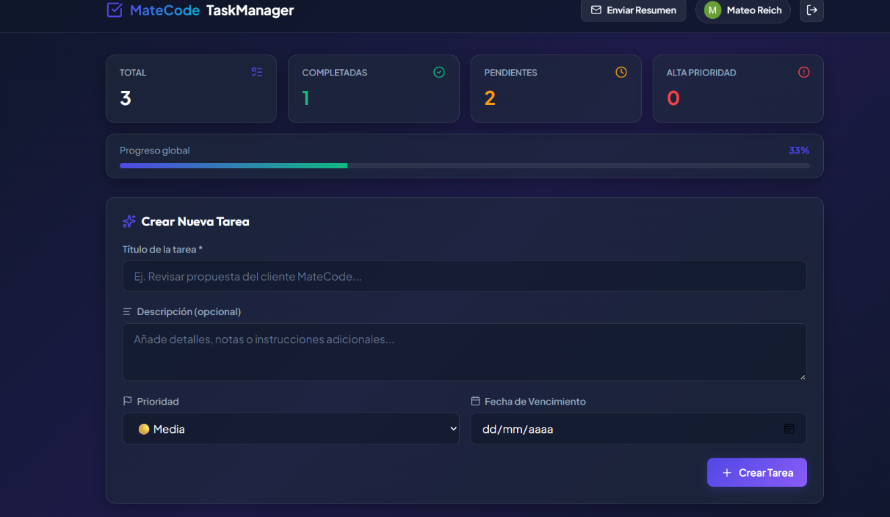
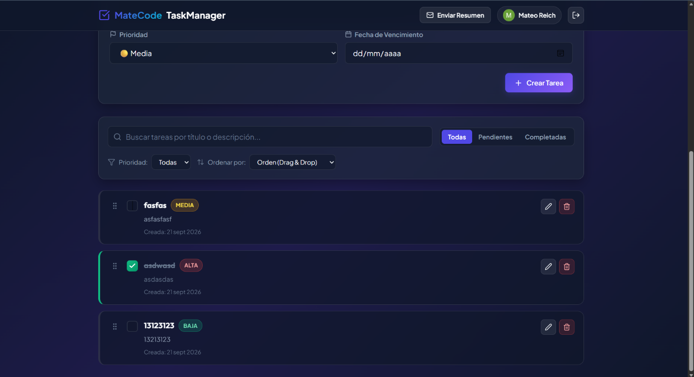
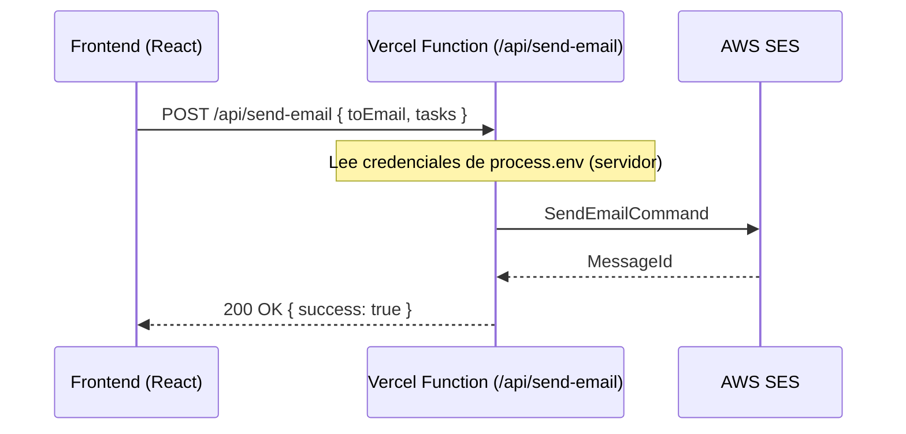

# MateCode — Gestor Estratégico de Tareas

SPA de gestión de tareas corporativas con autenticación, sincronización en tiempo real con Cloud Firestore y envío de resúmenes por email mediante AWS SES en una función Serverless de Vercel.

**Demo:** [pim-4-tau.vercel.app](https://pim-4-tau.vercel.app/dashboard)

**Stack:** React 19 · TypeScript · Vite · React Router · Firebase Auth · Cloud Firestore · AWS SES · Vercel Functions · Vitest · React Testing Library · dnd-kit

> Proyecto Integrador Final del programa Full Stack Web Development de Henry.

## Screenshots




## Características

- **Autenticación:** registro e inicio de sesión con email/contraseña y Google Sign-In, con mensajes de error de Firebase traducidos al español y rutas privadas protegidas (`ProtectedRoute`).
- **Tareas por usuario (CRUD):** título, descripción, prioridad (alta, media, baja) y fecha de vencimiento. Cada usuario ve solo sus tareas (filtradas por `userId`).
- **Tiempo real:** sincronización con Cloud Firestore mediante `onSnapshot`, con limpieza de suscripciones al desmontar componentes.
- **Búsqueda y filtros:** búsqueda por palabra clave, filtro por estado (todas, pendientes, completadas) y por prioridad.
- **Drag & drop:** reordenamiento de tareas con `@dnd-kit`.
- **Tareas vencidas:** indicador visual para las tareas fuera de fecha.
- **Resumen por email:** envío del resumen de tareas con AWS SES desde `/api/send-email`. Las credenciales de AWS viven solo en el servidor y hay un modo de simulación para desarrollo sin credenciales.
- **Pruebas automatizadas:** pruebas unitarias de utilidades y de componentes (`TodoForm`, `TodoList`, `ProtectedRoute`) con mocks de Firebase.

## Instalación

Requisitos: Node.js 20 o superior, un proyecto de Firebase (Auth con email/contraseña y Google, y Firestore) y, opcionalmente, una cuenta de AWS con SES configurado.

```bash
git clone https://github.com/ReichMateo/matecode.git
cd matecode
npm install
cp .env.example .env
```

Completá `.env` con tus datos:

```bash
# Firebase (frontend, variables públicas)
VITE_FIREBASE_API_KEY=
VITE_FIREBASE_AUTH_DOMAIN=
VITE_FIREBASE_PROJECT_ID=
VITE_FIREBASE_STORAGE_BUCKET=
VITE_FIREBASE_MESSAGING_SENDER_ID=
VITE_FIREBASE_APP_ID=

# AWS SES (solo servidor, sin prefijo VITE_)
AWS_ACCESS_KEY_ID=
AWS_SECRET_ACCESS_KEY=
AWS_REGION=us-east-1
AWS_SES_SENDER_EMAIL=noreply@tudominio.com
```

El archivo `.env` está en `.gitignore`: no lo subas al repositorio.

## Uso

```bash
npm run dev        # servidor de desarrollo en http://localhost:5173
npm run build      # build de producción
npm run test       # suite de pruebas (Vitest)
npm run test:watch # pruebas en modo watch
```

1. Registrate o iniciá sesión (email o Google).
2. Creá tareas con prioridad y fecha de vencimiento desde el dashboard.
3. Buscá, filtrá y reordená las tareas arrastrándolas.
4. Usá "Enviar resumen" para recibir tu lista de tareas por email.

## Estructura del proyecto

```text
├── api/                  # Función Serverless (envío de email con AWS SES)
│   └── send-email.ts
├── firestore.rules       # Reglas de seguridad de Firestore
└── src/
    ├── components/       # UI reutilizable (common, tasks, layout)
    ├── contexts/         # Estado global de autenticación
    ├── hooks/            # useAuth, useTasks, useToast
    ├── pages/            # Login, Register, Dashboard, NotFound
    ├── routes/           # Router y rutas protegidas/públicas
    ├── services/         # Firebase, taskService, emailService
    ├── types/            # Tipos de TypeScript
    ├── utils/            # Traducción de errores, formato de fechas
    └── test/             # Pruebas y mocks
```

La lógica de Firestore vive en `taskService.ts`, separada de la UI, lo que simplifica el testing.

## Flujo de envío de emails



## Uso de IA en el desarrollo

Usé IA como asistente de pair programming para: definir las interfaces de TypeScript del modelo de tareas, escribir la función que traduce errores de Firebase Auth, diseñar la función Serverless para invocar AWS SES sin exponer credenciales en el cliente y generar los mocks de Firebase para las pruebas. Revisé y adapté cada resultado antes de integrarlo.

## Autor

**Mateo David Reich** — Desarrollador Full Stack Jr.
[LinkedIn](https://linkedin.com/in/mateoreich) · [GitHub](https://github.com/ReichMateo)